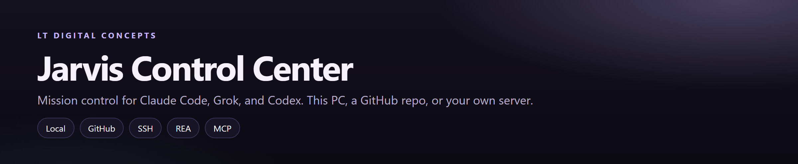
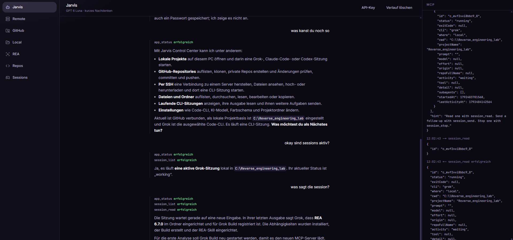
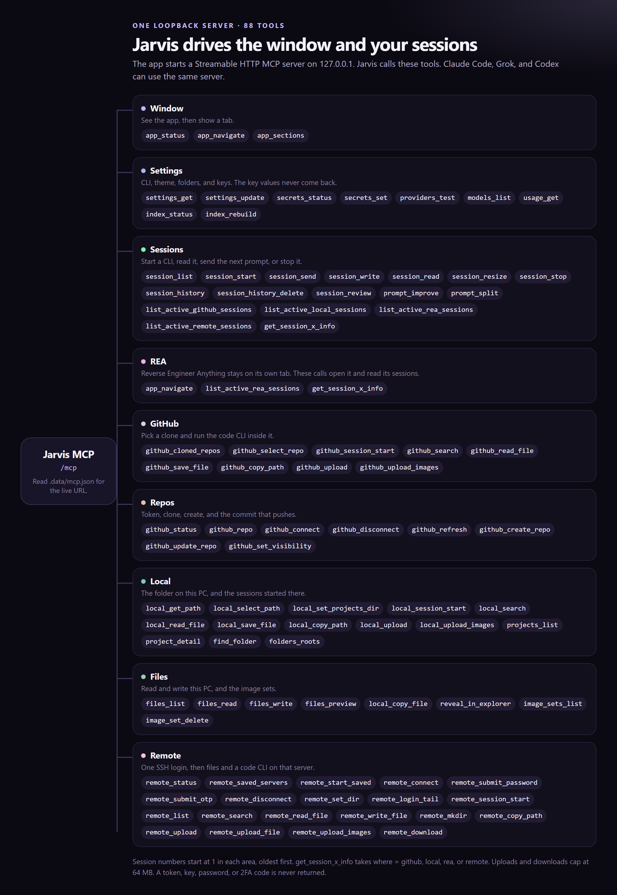
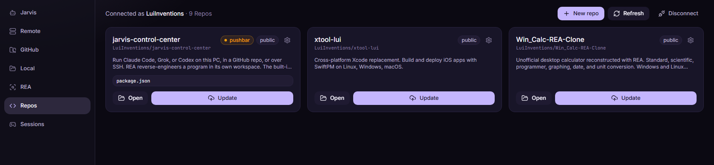
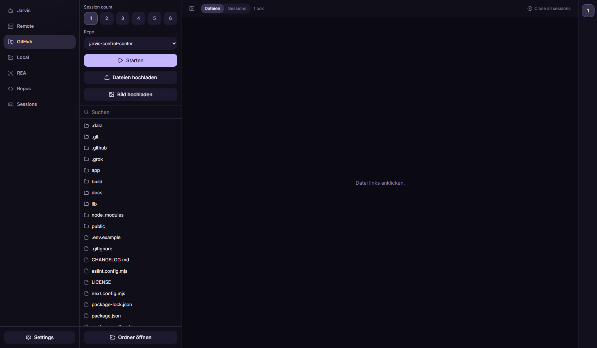
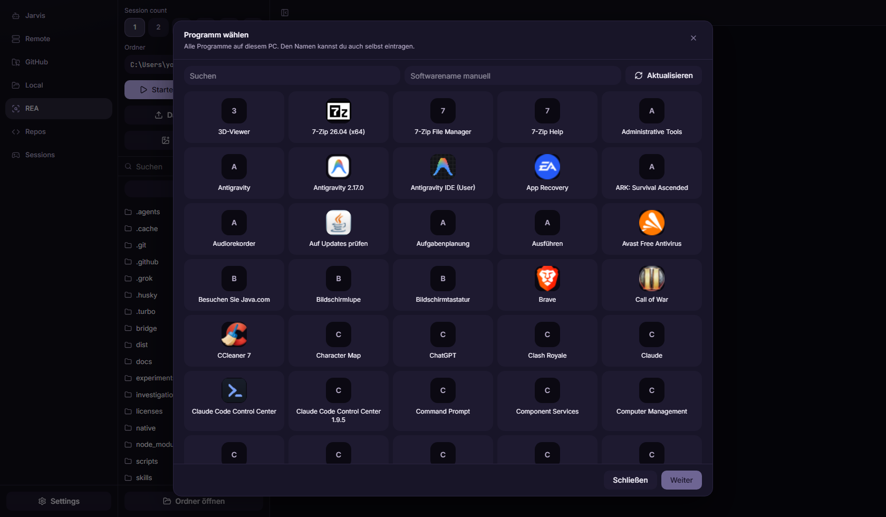
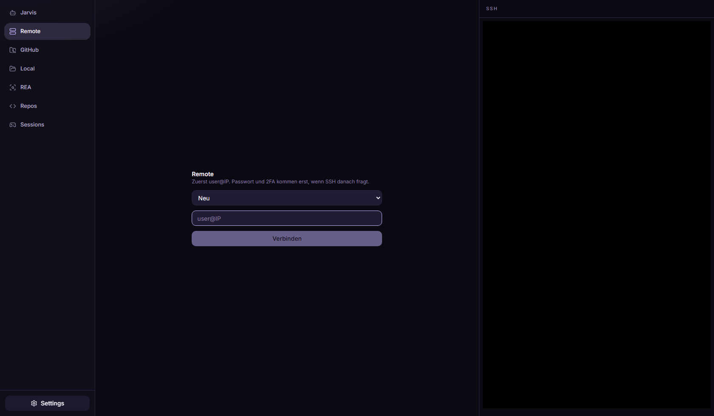
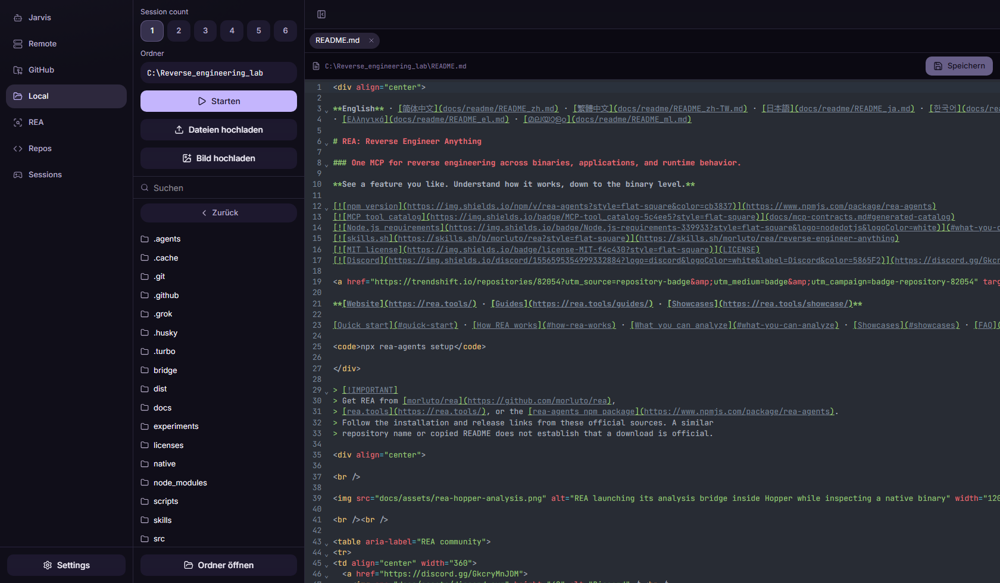
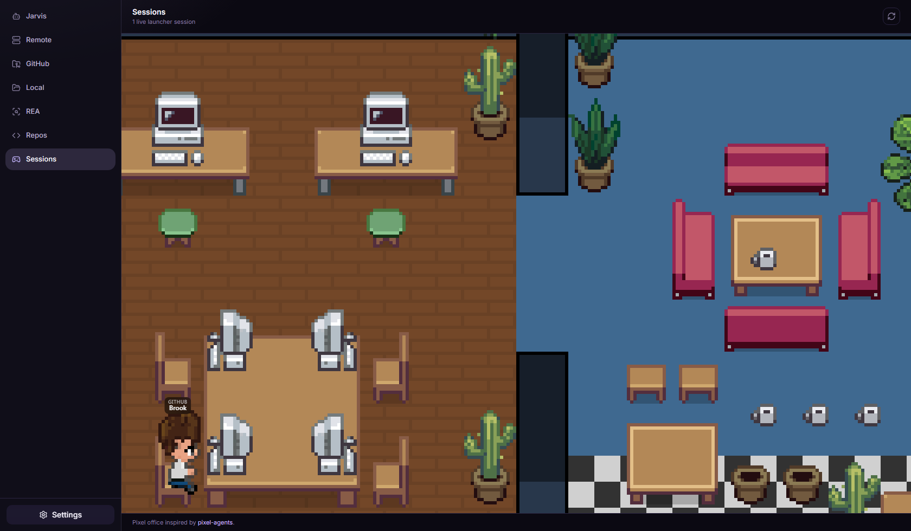
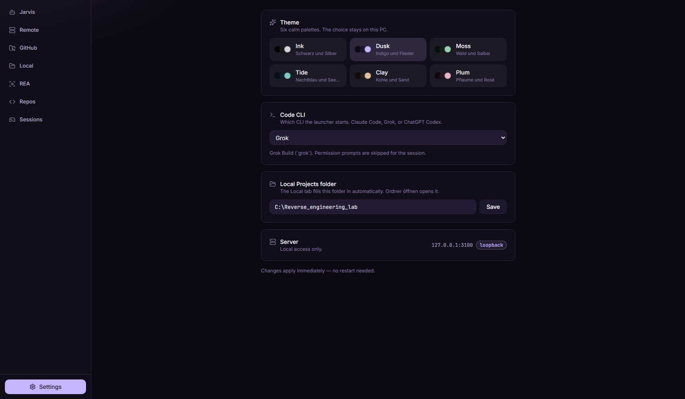

<p align="center">
  
</p>

<p align="center">
  <a href="https://github.com/LuiInventions/jarvis-control-center/stargazers"></a>
  <a href="https://github.com/LuiInventions/jarvis-control-center/forks"></a>
  <a href="https://github.com/LuiInventions/jarvis-control-center/issues"></a>
  <a href="https://github.com/LuiInventions/jarvis-control-center/blob/main/LICENSE"></a>
  <a href="https://github.com/LuiInventions/jarvis-control-center/releases/latest"></a>
</p>

<p align="center">
  One window for <b>Claude Code</b>, <b>Grok</b>, and <b>ChatGPT Codex</b>.<br />
  On this PC, in a cloned GitHub repo, or over SSH.
</p>

<p align="center">
  <a href="https://github.com/LuiInventions/jarvis-control-center/releases/latest"></a>
</p>

<p align="center">
  <b>v1.9.29</b> · <code>jarvis-control-center-Setup-1.9.29.exe</code> · <a href="CHANGELOG.md">Changelog</a><br />
  Listens only on <code>127.0.0.1</code>. The window is in English.
</p>

Sidebar: **Jarvis**, **Remote**, **GitHub**, **Local**, **REA**, **Repos**, **Sessions**, **Settings**. VS Codium is not in the sidebar.

---

## Jarvis



Jarvis is a chat with **GPT 6 Luna** (low reasoning). The OpenAI key is entered on this tab and stored with Windows DPAPI.

Each reply shows the tool calls. The panel on the right is the local MCP server. From the chat, Jarvis can open a tab, start a CLI, read what a session printed, and send the next prompt.

---

## MCP server

The app starts a stateless **Streamable HTTP** MCP server at `/mcp` on the same loopback port. While it runs, the URL is in `.data/mcp.json` and is cleared on shutdown.

```json
{
  "name": "jarvis-control-center",
  "transport": "streamable-http",
  "url": "http://127.0.0.1:3100/mcp"
}
```

Read `url` from that file. The port is 3100 unless it is taken.

Jarvis uses this server to manage the window and your sessions. Claude Code, Grok, or Codex can use the same URL: show a tab, open 1–6 terminals, read session 1, send the next line, or push a repo after you confirm. Secrets, tokens, passwords, and 2FA codes are never returned.



Call `app_status` first. Use ids and paths from tool results. Uploads and downloads cap at 64 MB. Image uploads cap at 10 and return `the images are in {folder}:`.

### Window

| Tool | What it does |
|---|---|
| `app_status` | Version, MCP URL, code CLI, folders, GitHub, SSH, and how many sessions are live. |
| `app_navigate` | Show Remote, GitHub, Local, REA, Repos, Sessions, or Settings. |
| `app_sections` | The sidebar sections and what each one is for. |

### Settings

| Tool | What it does |
|---|---|
| `settings_get` | Public settings. No API keys. |
| `settings_update` | Change the projects folder, code CLI, theme, or setup flag. |
| `secrets_status` | Which keys are stored. Values stay hidden. |
| `secrets_set` | Store or clear one provider key. |
| `providers_test` | Check that a stored key works. |
| `models_list` | Models for the active provider. |
| `usage_get` | Claude Code rate-limit windows tracked by this app. |
| `index_status` | When the local project index was last built. |
| `index_rebuild` | Rescan the projects folder. |

### Sessions

| Tool | What it does |
|---|---|
| `session_list` | Every code-CLI PTY still in memory. |
| `session_start` | Start Claude Code, Grok, or Codex in one PTY. |
| `session_send` | Send a follow-up and wait until output settles. |
| `session_write` | Send raw keys, such as Ctrl+C. |
| `session_read` | Readable tail of one session, with ANSI removed. |
| `session_resize` | Set the terminal grid. |
| `session_stop` | Stop one PTY. This cannot be resumed. |
| `session_history` | Saved launcher history. This is not the live list. |
| `session_history_delete` | Remove one history row. Does not stop a live PTY. |
| `session_review` | A markdown report of live sessions from the configured model. |
| `prompt_improve` | Rewrite a prompt using the folder on disk. Does not start a session. |
| `prompt_split` | Split one task into 1–6 prompts. |
| `list_active_github_sessions` | Number the running GitHub sessions. Session 1 is the oldest. |
| `list_active_local_sessions` | Number the running Local sessions. |
| `list_active_rea_sessions` | Number the running REA sessions. |
| `list_active_remote_sessions` | Number the running Remote sessions. |
| `get_session_x_info` | Read session `x` for `github`, `local`, `rea`, or `remote`, and copy that text. |

### GitHub

| Tool | What it does |
|---|---|
| `github_cloned_repos` | Clones that are already on disk. |
| `github_select_repo` | Show one clone on the GitHub tab. |
| `github_session_start` | Open 1–6 sessions in that clone. |
| `github_search` | Search file and folder names inside the clone. |
| `github_read_file` | Read a text file in the clone. |
| `github_save_file` | Save a text file. This does not commit. |
| `github_copy_path` | Copy a path inside the clone to the clipboard. |
| `github_upload` | Copy files and folders into the clone. |
| `github_upload_images` | Copy up to 10 images into an `image_set` folder. |

### Repos

| Tool | What it does |
|---|---|
| `github_status` | The signed-in user's repositories. |
| `github_repo` | Git summary and the files Update would ship. |
| `github_connect` | Store a personal access token and clone what is missing. |
| `github_disconnect` | Forget the token. Clones stay on disk. |
| `github_refresh` | Refresh the list and fast-forward clones that are on disk. |
| `github_create_repo` | Create a repository in the clones folder. |
| `github_update_repo` | Commit, merge, and push. `confirm` must be true. |
| `github_set_visibility` | Make a repository private or public. |

### Local

| Tool | What it does |
|---|---|
| `local_get_path` | The folder selected on Local. |
| `local_select_path` | Choose that folder. |
| `local_set_projects_dir` | Change the projects folder in Settings. |
| `local_session_start` | Open 1–6 sessions in the selected folder. |
| `local_search` | Search names under that folder. |
| `local_read_file` | Read a text file there. |
| `local_save_file` | Save a text file there. |
| `local_copy_path` | Copy a path to the clipboard. |
| `local_upload` | Copy files and folders into that folder. |
| `local_upload_images` | Copy images into an `image_set` folder. |
| `projects_list` | Subfolders of the projects directory. |
| `project_detail` | Stack, git, and README for one project. |
| `find_folder` | Search this PC for a folder by name. |
| `folders_roots` | The projects folder and the clones folder. |

### Files

| Tool | What it does |
|---|---|
| `files_list` | List a folder on this PC. Omit the path to list drives. |
| `files_read` | Read a text file. |
| `files_write` | Replace a UTF-8 text file. |
| `files_preview` | Preview a file, or a folder's README. |
| `local_copy_file` | Copy one file into a folder. |
| `reveal_in_explorer` | Open a path in Windows Explorer. |
| `image_sets_list` | Local copies of `image_set` folders. |
| `image_set_delete` | Delete one `image_set` folder and its cache. |

### Remote

| Tool | What it does |
|---|---|
| `remote_status` | The SSH login, the folder, and whether a password or code is needed. |
| `remote_saved_servers` | Saved servers. Passwords are not included. |
| `remote_start_saved` | Connect to a saved server. |
| `remote_connect` | Start SSH to a new host. |
| `remote_submit_password` | Answer the password prompt. `useSaved` sends the stored one. |
| `remote_submit_otp` | Answer the 2FA prompt. The code is not stored. |
| `remote_disconnect` | Close the SSH login. |
| `remote_set_dir` | Choose the remote folder. |
| `remote_login_tail` | Read the login terminal. Password and code characters are redacted. |
| `remote_session_start` | Open 1–6 sessions on the connected server. |
| `remote_list` | List a remote folder. |
| `remote_search` | Search names on the server. |
| `remote_read_file` | Read a remote text file. |
| `remote_write_file` | Save a remote text file. |
| `remote_mkdir` | Create one remote folder. Parents are not created for you. |
| `remote_copy_path` | Copy a remote path to the clipboard. |
| `remote_upload` | Copy files and folders to the server. |
| `remote_upload_file` | Copy one file to the server. |
| `remote_upload_images` | Copy images into a remote `image_set` folder. |
| `remote_download` | Save a remote file or folder onto this PC. |

A prompt named `drive-jarvis` carries the same notes.

---

## GitHub and Repos

The two tabs are one path: connect the account, work in the local clones, push from Repos.



**Repos.** Paste a personal access token. The app lists the repositories that token can see and clones each one onto this PC. Clones stay in `%LOCALAPPDATA%\Jarvis Control Center\github_repos` (a source checkout uses `github_repos` in the working directory), so an update does not delete them. **New repo** creates `<clones folder>/<name>` only. The token is an auth header. It is not written into `.git/config`.



**GitHub.** Pick one of those clones and press **Start**. That opens 1–6 sessions of the code CLI from Settings — Claude Code, Grok, or Codex — inside the clone. **Files** and **Sessions** switch the main area. **Upload files** and **Upload images** write into the clone on this PC.

When the sessions have changed files, go back to **Repos** and press **Update**. The dialog lists the files. **Push** then commits with `Update via Control Center`, fetches, merges, and pushes to `origin`. A merge conflict stops there and does not push. `git user.name` and `git user.email` must be set.

---

## REA



REA is a workspace for [Reverse Engineer Anything](https://github.com/morluto/rea). Sessions started here stay off Local and GitHub.

1. **New instance**, or open a folder that already has REA.
2. **Start setup now** sends an English setup prompt. It reads the REA repo, checks whether the MCP server or the plugin is already installed, and installs only what is missing. It then connects that MCP server to the current CLI session.
3. **Start REA** lists the programs on this PC, including ones with no executable. A name can be typed next to the list.

Then pick a mode. The feature and clone prompts are English.

| Mode | What you get |
|---|---|
| **Copy features** | One feature, traced and rebuilt in a project you name. `[feature]` stays for you to fill in. |
| **Copy the whole app** | The whole program, rebuilt as original code under a clone name you choose. |
| **Write your own prompt** | Only the agent role and the program name are filled in. |

The prompt opens in a tall editor. You can copy it or start a session in the REA folder. Only software you own or are allowed to study.

---

## Also in the window

### Remote



**Connect** with `user@IP` or a saved server. The password and 2FA fields appear only when SSH asks. **Start** opens 1–6 sessions in **Folder** on that login. **Upload files**, **Upload images**, and **Download** move files over the same SSH session.

### Local



Same launcher, against a folder on this PC. **Start** opens the code CLI there. Text can be saved in the editor.

### Sessions



Running agents appear in a pixel office, in the style of [pixel-agents](https://github.com/pixel-agents-hq/pixel-agents). The label is where the session started. Click a name to open that tab.

### Settings



**Code CLI** is Claude Code, Grok, or Codex. **Theme** is Ink, Dusk, Moss, Tide, Clay, or Plum. **Projects folder** is where Local starts. First launch asks for those two. It does not ask for an API key.

---

## Quick start

The installer does not need Node.

1. Download **`jarvis-control-center-Setup-<version>.exe`** from the [latest release](https://github.com/LuiInventions/jarvis-control-center/releases/latest).
2. Run it. It installs per user.
3. Pick the projects folder and the code CLI. Enter the OpenAI key later, on Jarvis.

Published by **LT Digital Concepts (Luis Kleemann)**. Until the build is signed, SmartScreen can say the publisher is unknown. **More info → Run anyway**. See [`build/SIGNING.md`](build/SIGNING.md).

Install the code CLI you selected and log in to it. Remote needs the **OpenSSH Client**.

<details>
<summary><strong>From source</strong></summary>

```powershell
git clone https://github.com/LuiInventions/jarvis-control-center
cd jarvis-control-center
.\setup.ps1
npm run dev
```

Open **http://127.0.0.1:3100**. If PowerShell blocks the script: `powershell -ExecutionPolicy Bypass -File .\setup.ps1`.

`npm run electron:build` writes the installer to `build/dist/`.

</details>

---

## Requirements

- **Windows 11**. A source checkout also needs **Node.js ≥ 20.9** and **git** (`user.name` and `user.email`).
- One code CLI, installed and logged in: [Claude Code](https://docs.anthropic.com/en/docs/claude-code), [Grok](https://x.ai/cli), or ChatGPT Codex (`codex`).
- **OpenSSH Client** for Remote.
- An **OpenAI API key** on the Jarvis tab.

| Variable | What it controls | Default |
|---|---|---|
| `OPENAI_API_KEY` | Optional fallback for the Jarvis key. Server-side only. | – |
| `PROJECTS_DIR` | Folder Local starts from | `./projects` |
| `HOST` | Bind address. Leave this. | `127.0.0.1` |
| `PORT` | Port | `3100` |
| `CLAUDE_BIN` | Explicit path to the Claude CLI | auto |

Settings override environment variables. The desktop app stores the GitHub token and the Jarvis key with DPAPI.

---

## Security

- Binds to `127.0.0.1`. `/mcp` from anywhere else is refused.
- No separate login. One person, this PC.
- Sessions skip the CLI permission prompt: Claude `--dangerously-skip-permissions`, Grok `--permission-mode bypassPermissions`, Codex `--dangerously-bypass-approvals-and-sandbox`.
- A push runs only after **Push**, or when `github_update_repo` is called with `confirm: true`.

---

## License

MIT. See [LICENSE](LICENSE).
